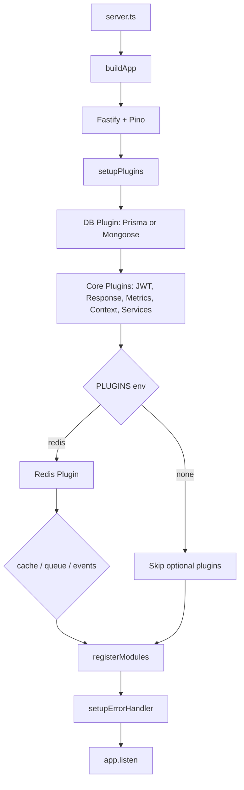
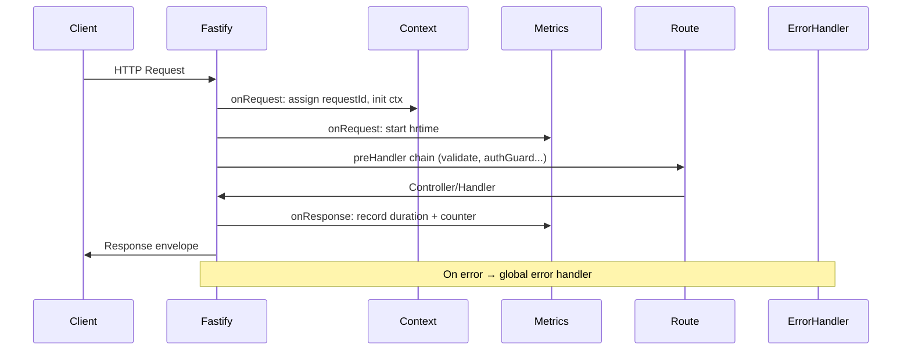

# Techunico Node Framework — Detailed Analysis Report

**Project:** `nodejs_framework`  
**Author analysis based on:** Full codebase review  
**Date:** June 28, 2026  
**Stack:** Fastify 5, Prisma 7, Mongoose (optional), Redis (ioredis), BullMQ, Socket.io, TypeScript, Zod, Pino, Prometheus

---

## 1. Executive Summary

You have designed an **opinionated, modular Node.js backend framework** branded as **Techunico Node Framework**. It is not a minimal starter — it is a **production-oriented application skeleton** with explicit architectural layers, a plugin composition model, and tooling to scaffold new projects and modules.

The framework follows a philosophy stated in the README:

- **Simplicity over magic**
- **Explicit over implicit**
- **Composition over inheritance**

At a high level, the system boots a Fastify application, conditionally loads a database provider (PostgreSQL via Prisma or MongoDB via Mongoose), registers core infrastructure plugins, optionally enables Redis-backed capabilities (cache, queues, events), auto-discovers feature modules from `src/modules/`, and exposes versioned REST APIs with consistent response envelopes, structured logging, health checks, and Prometheus metrics.

The README describes this as **Phase 1**, but the codebase already contains substantial **Phase 2** capabilities (Redis, BullMQ, events, Socket.io, presence, rate limiting) — many of which are implemented but not fully wired into the default bootstrap path.

---

## 2. Framework Identity

| Aspect | Detail |
|--------|--------|
| **Name** | Techunico Node Framework |
| **Distribution** | `create-techunico-app` CLI package scaffolds new projects from a built template |
| **Runtime** | Node.js ≥ 16 |
| **Language** | TypeScript (strict mode, path aliases `@/*`) |
| **HTTP Server** | Fastify 5 with `fastify-plugin` encapsulation |
| **Primary pattern** | Modular monolith with plugin-based infrastructure |

The framework is designed to be **reused across projects**: `npm run build:template` copies the core `src/` tree into a distributable template, and the CLI (`packages/create-techunico-app`) lets developers pick database and optional plugins at project creation time.

---

## 3. Application Bootstrap & Lifecycle

### 3.1 Entry Point

```
server.ts → buildApp() → app.listen()
```

**`src/server.ts`** loads environment variables via `dotenv`, builds the app, and listens on `0.0.0.0` using the configured port.

**`src/app.ts`** is the composition root:

1. Create Fastify instance with Pino logger config
2. `setupPlugins(app)` — register all infrastructure plugins
3. `registerModules(app)` — auto-load feature modules
4. `setupErrorHandler(app)` — global error normalization
5. Return configured app (used by tests via `app.inject()`)

Event listener auto-loading (`loadEventListeners`) is present but **commented out** — marked as experimental.

### 3.2 Startup Flow Diagram



---

## 4. Configuration System

Configuration is **validated at startup** using **Zod** (`src/config/env.schema.ts`). Invalid environment variables cause a hard failure with formatted error output — a strong production practice.

### 4.1 Environment Variables

| Variable | Purpose |
|----------|---------|
| `NODE_ENV` | `development` \| `production` \| `test` |
| `PORT` | HTTP listen port (default: 3000) |
| `DATABASE_URL` | Prisma/SQLite connection string |
| `DB_PROVIDER` | `postgresql`, `sqlite`, or `mongodb` |
| `JWT_SECRET` | JWT signing secret (min 10 chars) |
| `LOG_LEVEL` | Pino log level |
| `API_PREFIX` | API route prefix (default: `/api`) |
| `API_VERSION` | API version segment (default: `v1`) |
| `REDIS_HOST`, `REDIS_PORT`, `REDIS_PASSWORD` | Redis connection |
| `PLUGINS` | Comma-separated optional plugin list |
| `MONGO_URI` | MongoDB connection (Mongoose path) |

### 4.2 Plugin Activation Model

Optional plugins are **not auto-enabled**. They are activated via the `PLUGINS` environment variable:

```
PLUGINS=redis,cache,queue,events
```

A CLI helper exists:

```bash
npm run plugin:add redis
```

This appends the plugin name to `.env` without duplicates.

### 4.3 Config Object Shape

`src/config/index.ts` exposes a typed `config` object grouping:

- `app` — env, port, API prefix/version, enabled plugins
- `db` — URL and provider
- `jwt` — secret
- `log` — level
- `redis` — host, port, password

---

## 5. Plugin Architecture

Plugins are the **primary extensibility mechanism**. They use `fastify-plugin` to break encapsulation where needed and decorate the Fastify instance with shared services.

### 5.1 Plugin Registration Order (`src/plugins/index.ts`)

| Order | Plugin | Required | Depends On |
|-------|--------|----------|------------|
| 1 | Database (Prisma or Mongoose) | Yes | — |
| 2 | JWT | Yes | — |
| 3 | Response | Yes | — |
| 4 | Metrics | Yes | — |
| 5 | Context | Yes | — |
| 6 | Services | Yes | — |
| 7 | Redis | Optional | — |
| 8 | Cache | Optional | Redis |
| 9 | Queue (BullMQ) | Optional | Redis |
| 10 | Events | Optional | Redis + Queue |

**Dependency enforcement:** If `cache`, `queue`, or `events` is enabled without `redis`, the framework logs a warning and skips registration.

### 5.2 Plugins Present but Not in Default Registry

These exist in `src/plugins/` but are **not registered** in `registerPlugins()`:

| Plugin | Purpose |
|--------|---------|
| `realtime` | Socket.io server with JWT auth, tenant rooms, presence hooks |
| `presence` | Redis-backed online/offline tracking per user and tenant |
| `rate-limit` | Redis sliding-window counter (`incr` + `expire`) |
| `multitenancy` | Tenancy resolver service (mostly commented out) |
| `logger` | Additional logging plugin |

These represent **advanced/real-time capabilities** that are architecturally designed but require manual registration or future integration into the plugin manifest.

---

## 6. Database Layer — Dual Provider Strategy

A key design decision is **database provider abstraction** via a common `DatabaseAdapter` interface:

```typescript
interface DatabaseAdapter {
  connect(): Promise<void>
  disconnect(): Promise<void>
  getClient(): unknown
}
```

Both Prisma and Mongoose adapters implement this contract and decorate the Fastify instance as `app.db`.

### 6.1 PostgreSQL / SQLite — Prisma 7

**File:** `src/plugins/db-prisma/prisma.plugin.ts`

- Uses **Prisma 7 driver adapters** (not the legacy direct connection model):
  - `PrismaPg` + `pg.Pool` for PostgreSQL
  - `PrismaBetterSqlite3` for SQLite (local `dev.db`)
- Client output is generated to `src/generated/prisma`
- Separate schema files: `schema.postgresql.prisma`, `schema.sqlite.prisma`
- Separate migration histories per provider via `prisma.config.ts`

**Schema models (PostgreSQL):**

- `User` — id, name, email, password, roleId, createdAt
- `Role` — id, name (unique)
- `Permission` — id, name (unique)
- Many-to-many: `Role` ↔ `Permission`

This establishes an **RBAC data model** at the database level.

**Important architectural shift:** The plugin exposes `app.db` (generic adapter) and has **removed** direct `app.prisma` decoration (commented out in code). However, several modules still reference `request.server.prisma` — indicating an **in-progress migration** to the adapter pattern.

### 6.2 MongoDB — Mongoose

**File:** `src/plugins/db-mongoose/mongoose.plugin.ts`

- Connects via `MONGO_URI` environment variable
- Exposes `mongoose` instance through `app.db.getClient()`
- Module generator creates `model.ts` instead of `repository.ts` when `DB_PROVIDER=mongodb`

### 6.3 Repository Pattern

**`BaseRepository<T>`** (`src/core/base.repository.ts`) provides Prisma-style CRUD:

- `findAll`, `findById`, `paginate`, `create`, `update`, `delete`, `count`, `exists`

`UserRepository` extends this base class and adds domain-specific queries (`findByEmail`, `findAuthUserByEmail`, `findRoleByName`) with role/permission eager loading for auth flows.

The module scaffold service template (`service.ts.txt`) is **DB-agnostic** — it checks for Prisma `findMany` or Mongoose `model()` at runtime.

---

## 7. Redis Plugin

**File:** `src/plugins/redis/redis.plugin.ts`

- Creates a single **ioredis** connection using config values
- Decorates `app.redis`
- Logs connect/error events
- Gracefully quits on `onClose` hook

Redis is the **shared infrastructure backbone** for:

- Cache
- BullMQ queues
- Rate limiting
- Presence tracking
- (Potentially) session storage in future

---

## 8. Cache Layer

**File:** `src/plugins/cache/cache.service.ts`

`CacheService` wraps Redis with JSON serialization:

| Method | Behavior |
|--------|----------|
| `set(key, value, ttl?)` | Store with optional TTL (`EX`) |
| `get<T>(key)` | Deserialize or return null |
| `del(key)` | Delete key |
| `remember(key, ttl, fn)` | Cache-aside pattern |
| `flush(pattern)` | Delete keys matching pattern via `KEYS` + `DEL` |

The `remember` helper is particularly useful for reducing database load on hot read paths.

---

## 9. Queue System — BullMQ

### 9.1 Queue Plugin

**File:** `src/plugins/queue/queue.service.ts`

`QueueService` maintains a **lazy Map of BullMQ Queue instances** keyed by queue name, all sharing the same Redis connection.

The `add()` API:

```typescript
await queue.add(queueName, jobName, data, {
  delay?: number
  attempts?: number      // default: 3
  removeOnComplete?: boolean  // default: true
})
```

### 9.2 Workers (Separate Processes)

Workers live in `src/queues/workers/` and are designed to run **independently** from the HTTP server:

| Worker | Queue | Jobs |
|--------|-------|------|
| `email.worker.ts` | `email` | `send-welcome-email` |
| `events.worker.ts` | `events` | Dispatches by `event` name (e.g. `user.created`) |

Workers bootstrap their own Redis connection via `src/bootstrap/config.ts`.

### 9.3 Job Definitions

`src/queues/jobs/email.job.ts` defines queue name constants and job name enums — a clean separation between producers and consumers.

**Observation:** Workers are scaffolded with `console.log` placeholders. The HTTP app enqueues jobs via `app.queue`, but worker processes must be started separately (not automated in `package.json` scripts yet).

---

## 10. Event System

The event system is a **lightweight in-process pub/sub** with optional **async delegation to BullMQ**.

### 10.1 Components

| File | Role |
|------|------|
| `events/event.service.ts` | Registry + `emit()` dispatcher |
| `events/event.types.ts` | `EventListener` interface (`event`, `handler`, `async?`) |
| `events/event.loader.ts` | Auto-discovers `*.listener.js` files from `dist/events/listeners` |
| `events/event.registry.ts` | Manual registration fallback |
| `plugins/events/events.plugin.ts` | Decorates `app.event` |

### 10.2 Dispatch Semantics

When `event.emit('user.created', payload)` is called:

1. All registered listeners for `user.created` are retrieved
2. If `listener.async === true` → job is pushed to the `events` BullMQ queue
3. If `listener.async === false` → handler runs synchronously in-process

**Example listener:** `send-welcome-email.listener.ts` listens for `user.created` with `async: true`.

### 10.3 Integration Status

- Event plugin requires `queue` + `redis` plugins
- Auto-loading via `loadEventListeners` is **disabled** in `app.ts`
- Manual registry exists but is also not called in bootstrap
- The event system is **architecturally complete** but **not active by default**

---

## 11. Authentication & Security

### 11.1 JWT Plugin

**File:** `src/plugins/jwt.plugin.ts`

Custom JWT implementation (not `@fastify/jwt`) with:

| Feature | Detail |
|---------|--------|
| **User types** | `admin`, `user`, `driver` |
| **Token types** | `access`, `refresh` |
| **Per-user-type secrets** | Admin uses hardcoded `secret_admin`; others use `JWT_SECRET` |
| **Expiry** | Access: `15y` (likely dev placeholder); Refresh: `30d` |
| **API** | `sign`, `verifyToken`, `verifyAccess`, `verifyRefresh`, `refresh` |

Tokens embed `userType` and `tokenType` in the payload for verification routing.

### 11.2 Auth Guard

**File:** `src/core/auth.guard.ts`

- Validates `Authorization: Bearer <token>` header
- Verifies access token via `request.server.jwt.verifyAccess`
- Populates `request.ctx.user` with `{ id, role, permissions, type }`
- Enriches request logger with user context

### 11.3 Auth Module

**Routes** (under `/api/v1/auth`):

| Method | Path | Guards | Description |
|--------|------|--------|-------------|
| POST | `/register` | `validateBody` | Create user with bcrypt-hashed password |
| POST | `/login` | `validateBody` | Authenticate and return JWT |
| GET | `/me` | `authGuard` | Return current user from context |

**AuthService** handles registration (email uniqueness, default `user` role assignment) and login (bcrypt compare, role/permission hydration).

### 11.4 RBAC Data Model vs Implementation

The database supports full RBAC (roles, permissions, many-to-many), and login returns permissions in the JWT payload. However:

- **`permissionGuard` is documented in README but not implemented** in the codebase
- Permissions are carried in tokens but not enforced on routes yet

---

## 12. Request Pipeline

### 12.1 Per-Request Lifecycle



### 12.2 Request Context (`request.ctx`)

Initialized in `context.plugin.ts`:

```typescript
request.ctx = { requestId: UUID }
// After authGuard:
request.ctx.user = { id, role, permissions, type }
```

Designed for future tenant injection (`request.ctx.tenant` is commented).

### 12.3 Service Container (`request.services`)

`services.plugin.ts` initializes an empty `request.services = {}` per request.

Module augmentation in `auth.types.ts` extends `BaseServices` with `auth: AuthService`, but **the plugin does not currently populate `request.services.auth`** — the wiring is incomplete. `AuthController` expects `request.services.auth` to exist.

This is a **DI-lite pattern** (inspired by NestJS/Angular service containers) that is mid-implementation.

### 12.4 Response Envelope

All responses follow a consistent shape via `reply.success()` / `reply.error()`:

```json
{
  "success": true | false,
  "data": { ... } | null,
  "error": { "type": "...", "message": "...", "details": [...] } | null
}
```

The global error handler normalizes `ZodError`, `AppError`, Fastify errors, and unknown exceptions into this format.

---

## 13. Validation Layer

**Zod** is used throughout:

- Environment validation (`env.schema.ts`)
- Request validation middleware (`validation.middleware.ts`)
- Per-module schemas (e.g. `auth.schema.ts`, `user.schema.ts`)

Middleware functions:

- `validateBody(schema)`
- `validateQuery(schema)`
- `validateParams(schema)`

On failure, a `ZodError` is thrown and caught by the global error handler, returning field-level `details`.

---

## 14. Module System

### 14.1 Auto-Registration

**File:** `src/core/module-loader.ts`

- Scans `src/modules/` for directories **not prefixed with `_`**
- Requires `{dir}Module` export from `index.ts` (e.g. `authModule`)
- Registers with Fastify using computed prefix:

| Module Type | Prefix |
|-------------|--------|
| System modules (`health`, `metrics`) | No prefix (root-level) |
| Feature modules | `/api/v1/{kebab-case-name}` |

### 14.2 Existing Modules

| Module | Route Base | Purpose |
|--------|------------|---------|
| `auth` | `/api/v1/auth` | Register, login, me |
| `user` | `/api/v1/user` | List users |
| `health` | `/health`, `/ready` | Liveness and readiness probes |
| `metrics` | `/metrics` | Prometheus scrape endpoint |
| `_template` | (excluded) | Reference module for scaffolding |

### 14.3 Module Internal Structure

Each module follows a **layered architecture**:

```
module/
├── index.ts          # Module registration entry ({name}Module)
├── {name}.routes.ts  # Route definitions + preHandlers
├── {name}.controller.ts
├── {name}.service.ts
├── {name}.repository.ts  # Prisma path
├── {name}.model.ts       # Mongoose path
├── {name}.schema.ts      # Zod validation schemas
└── {name}.types.ts       # Module-specific types (optional)
```

### 14.4 Module Generator

```bash
npm run make:module <name>
```

- Reads templates from `src/scripts/templates/module/`
- Detects `DB_PROVIDER` from `.env` to generate `repository.ts` (PostgreSQL) or `model.ts` (MongoDB)
- Performs name substitution (`{{name}}`, `{{pascalName}}`, `{{camelName}}`)

---

## 15. Observability

### 15.1 Structured Logging

- **Pino** via Fastify's built-in logger
- **pino-pretty** in development (colorized, timestamped)
- Request-scoped child loggers with `requestId` and post-auth `userId`

### 15.2 Prometheus Metrics

**File:** `src/core/metrics.ts` + `metrics.plugin.ts`

| Metric | Type | Labels |
|--------|------|--------|
| `http_requests_total` | Counter | method, route, status |
| `http_request_duration_seconds` | Histogram | method, route, status |
| Default Node metrics | Gauge/Counter | (via `collectDefaultMetrics`) |

Metrics are recorded on `onResponse` using `process.hrtime()` for precise duration.

Exposed at `GET /metrics` (system module, no API prefix).

### 15.3 Health Checks

| Endpoint | Type | Checks |
|----------|------|--------|
| `GET /health` | Liveness | Uptime, timestamp |
| `GET /ready` | Readiness | Database (`SELECT 1`), Redis (`PING`) |

Readiness returns `503` with per-service status when degraded.

**Note:** Readiness currently calls `request.server.prisma.$queryRaw` and `app.redis` — the prisma reference may fail if only `app.db` is exposed.

---

## 16. Real-Time & Advanced Plugins (Designed, Partially Integrated)

### 16.1 Socket.io Realtime

`realtime.plugin.ts` attaches Socket.io to the Fastify HTTP server with:

- JWT authentication via `handshake.auth.token`
- Server-controlled room joining (`user:{id}`, `tenant:{tenantId}`)
- Integration with `presence` and `rateLimit` services
- `RealtimeService` helpers: `emitToUser`, `emitToTenant`, `toRoom`

Marked in `app.ts` as experimental.

### 16.2 Presence Service

Redis-backed connection counting:

- `userConnected` / `userDisconnected` — ref-count per user, set per tenant
- `isOnline`, `getOnlineUsers`, `getLastSeen`
- Supports multi-tab/device scenarios via increment/decrement

### 16.3 Rate Limiting

Two implementations:

1. **`RateLimitService`** — Redis `INCR` + `EXPIRE` sliding window
2. **`rateLimitMiddleware`** — HTTP middleware using tenant + user + route key
3. **WebSocket rate limiting** — inline in realtime plugin (`20 req / 60s`)

### 16.4 Multitenancy

`tenancy.service.ts` is stubbed/commented. Context plugin has placeholder for `request.ctx.tenant`. Realtime and rate-limit code already assume `tenantId` exists on users — multitenancy is **anticipated** but not fully implemented.

### 16.5 Streaming Service

`stream.service.ts` is commented out but shows intent for **chunked real-time delivery** via `AsyncGenerator` → Socket.io events.

---

## 17. Error Handling

**`AppError`** (`src/utils/app-error.ts`) is the application-level error type with:

- `message`, `statusCode`, `code`/`type` (from `ErrorCodes` enum)

**Global error handler** (`src/core/error-handler.ts`) handles:

| Error Type | Status | Response Type |
|------------|--------|---------------|
| `ZodError` | 400 | `VALIDATION_ERROR` with field details |
| `AppError` | Custom | Typed error code + message |
| `FastifyError` | Variable | `HTTP_ERROR` |
| Unknown | 500 | `INTERNAL_SERVER_ERROR` (message hidden in production) |

---

## 18. Developer Experience Tooling

### 18.1 CLI: `create-techunico-app`

Interactive project scaffolding:

1. Project name
2. Database choice (PostgreSQL/Prisma or MongoDB/Mongoose)
3. Optional plugins (Redis, Queue, Socket.io)
4. Package manager (npm/yarn/pnpm)

Generates tailored `package.json` dependencies and `.env` with correct `DB_PROVIDER`.

### 18.2 Template Build Pipeline

`npm run build:template`:

- Copies `src/` to distributable template
- Strips generated Prisma artifacts
- Sanitizes `package.json` scripts
- Syncs to `packages/create-techunico-app/template`

### 18.3 Scripts Summary

| Script | Purpose |
|--------|---------|
| `dev` | ts-node-dev with path aliases |
| `make:module` | Scaffold new feature module |
| `plugin:add` | Enable plugin in `.env` |
| `migrate:pg` / `migrate:sqlite` | Prisma migrations per provider |
| `generate:pg` / `generate:sqlite` | Prisma client generation |
| `test` | Jest + supertest (via `app.inject`) |
| `typecheck` | `tsc --noEmit` |

---

## 19. Testing Strategy

- **Jest** with **ts-jest**
- Tests use Fastify's `inject()` — no real HTTP server needed
- `health.test.ts` validates `GET /health` returns 200
- Test env provides defaults for `DATABASE_URL`, `JWT_SECRET`, `PLUGINS`

Testing infrastructure is minimal but correctly uses the `buildApp()` composition root.

---

## 20. Type System & Fastify Augmentation

**`src/types/fastify.d.ts`** extends Fastify interfaces:

| Extension | Properties |
|-----------|------------|
| `FastifyInstance` | `logger`, `prisma`, `db`, `jwt`, `cloudinary` |
| `FastifyRequest` | `user`, `requestId`, `ctx`, `services`, `startTime` |
| `FastifyReply` | `success()`, `error()` |

Plugin-specific augmentations (redis, cache, queue, event, realtime, presence, rateLimit) are co-located in their respective plugin files.

Path alias `@/*` maps to `src/*` for clean imports.

---

## 21. Architectural Strengths

1. **Clear separation of concerns** — routes → controllers → services → repositories
2. **Plugin composition with explicit dependency rules** — Redis required for cache/queue/events
3. **Database provider swap** without changing module structure (adapter + scaffold branching)
4. **Validated configuration** — fail-fast on bad env
5. **Consistent API contract** — envelope responses + typed error codes
6. **Production observability** — health, readiness, Prometheus metrics, structured logging
7. **Scalable async processing** — BullMQ workers decoupled from HTTP process
8. **Developer velocity** — module generator, project CLI, plugin toggles via env
9. **Prisma 7 modern stack** — driver adapters, multi-schema, per-provider migrations
10. **Forward-looking design** — multitenancy hooks, presence, realtime, event-driven patterns

---

## 22. Gaps, Inconsistencies & Work-in-Progress Areas

An honest assessment of current codebase state:

| Area | Status |
|------|--------|
| `app.prisma` vs `app.db` | Prisma plugin removed `app.prisma` decoration, but `user.controller`, `health.routes`, and `AuthService` still use `prisma` directly |
| `request.services` DI | Container initialized empty; `AuthController` expects `services.auth` but nothing wires it |
| `permissionGuard` | Documented in README, not implemented |
| Event auto-loading | Implemented but disabled in `app.ts` |
| Realtime/Presence/RateLimit plugins | Built but not in `registerPlugins()` |
| Mongoose dependency | Plugin and templates exist, but `mongoose` is not in root `package.json` dependencies |
| JWT access token expiry | Set to `15y` — almost certainly a development placeholder |
| Admin JWT secret | Hardcoded `secret_admin` — security risk for production |
| BullMQ workers | No npm script to start workers; placeholder handlers only |
| README Phase 2 | Lists Redis/queues/events as "planned" but code already exists |
| `cloudinary` type | Declared in `fastify.d.ts` but no plugin found |
| Auth login token | `jwt.sign()` called without explicit `tokenType` / `userType` arguments — relies on defaults |

These are not flaws in the design vision — they indicate an **actively evolving framework** where Phase 2 features are being built incrementally on top of a solid Phase 1 core.

---

## 23. Data Flow Examples

### 23.1 User Registration Flow

```
POST /api/v1/auth/register
  → validateBody(registerSchema)
  → AuthController.register()
  → AuthService.register()
    → UserRepository.findByEmail() — check duplicate
    → bcrypt.hash(password)
    → UserRepository.findRoleByName('user')
    → UserRepository.create()
  → reply.success(user)
```

### 23.2 Async Event Flow (when enabled)

```
AuthService.register() completes
  → app.event.emit('user.created', { email })
    → sendWelcomeEmailListener (async: true)
      → queue.add('events', 'user.created', { event, payload })
        → events.worker.ts processes job
          → handler logic (e.g. send email)
```

### 23.3 Readiness Probe Flow

```
GET /ready
  → prisma.$queryRaw SELECT 1
  → redis.ping()
  → aggregate check statuses
  → 200 (ready) or 503 (degraded)
```

---

## 24. Recommended Evolution Path

Based on the current architecture, logical next steps to bring the framework to full coherence:

1. **Complete the DB adapter migration** — access DB only via `app.db.getClient()` or a typed helper; remove stale `app.prisma` references
2. **Wire the service container** — populate `request.services` in `onRequest` with lazily constructed services (auth, user, etc.)
3. **Implement `permissionGuard`** — check `request.ctx.user.permissions` against required permissions
4. **Register advanced plugins** — add `realtime`, `presence`, `rate-limit` to the `PLUGINS` manifest
5. **Enable event loading** — uncomment `loadEventListeners` or call `registerEventListeners` after event plugin registration
6. **Add worker scripts** — `npm run worker:email`, `npm run worker:events`
7. **Harden JWT config** — env-driven secrets per user type, sensible access token TTL
8. **Add `mongoose` to dependencies** when MongoDB path is selected
9. **Expand test coverage** — auth flows, validation errors, readiness degradation, queue integration

---

## 25. Conclusion

You have designed a **well-structured, production-minded Fastify framework** that goes significantly beyond a typical boilerplate. The architecture demonstrates mature thinking:

- **Infrastructure as composable plugins** rather than monolithic setup
- **Feature code isolated in auto-loaded modules** with predictable layering
- **Redis as a shared foundation** for cache, jobs, rate limits, and presence
- **Dual database support** without forking the entire codebase
- **CLI-driven project and module generation** for team scalability

The framework sits at an inflection point: **Phase 1 (HTTP API, auth, validation, observability) is largely complete**, while **Phase 2 (events, queues, realtime, multitenancy) is architecturally laid out but partially wired**. The codebase reads as a framework designer's working blueprint — explicit, composable, and intentionally extensible — with clear seams for completing the remaining integrations.

---

*This report reflects the codebase as observed on June 28, 2026. File paths and behaviors reference the `nodejs_framework` repository at analysis time.*