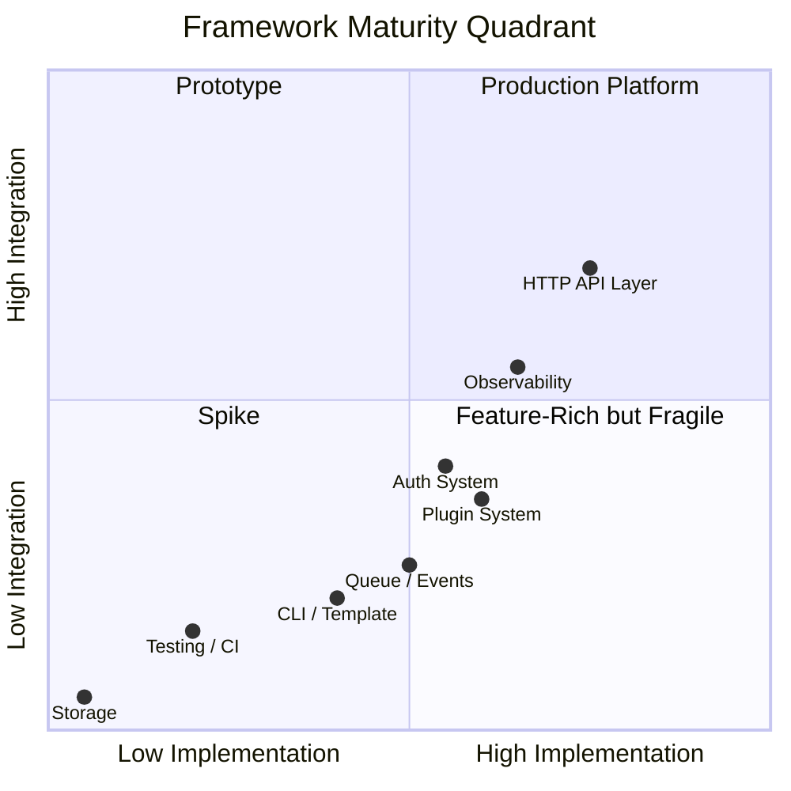
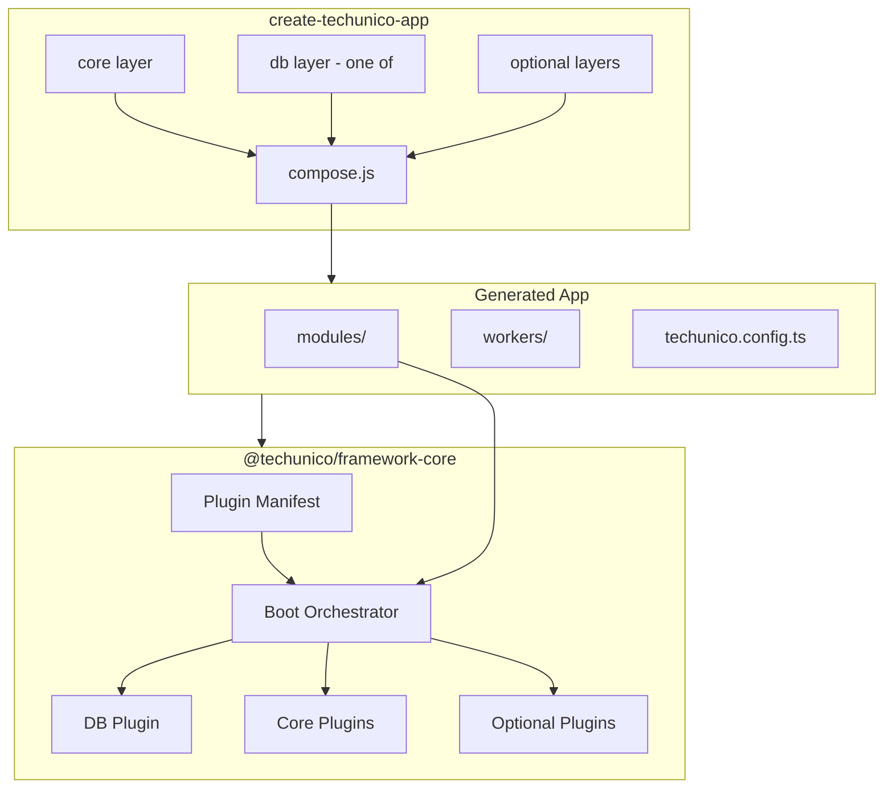

# Techunico Node Framework — Architecture Gap & Impact Analysis (Pre-v2 Review)

**Review type:** Senior architecture review (pre-v2 release gate)  
**Scope:** Architecture, scalability, DX, maintainability, release readiness, ecosystem design  
**Reference:** `anlysysRport.md` (current implementation baseline)  
**Date:** June 28, 2026  
**Assumption:** This framework becomes the standard backend platform for all Techunico products.

---

## 1. Executive Summary

The Techunico Node Framework has a **sound architectural vision**: modular monolith, plugin-composed infrastructure, auto-loaded feature modules, validated configuration, and consistent API contracts. The design choices — explicit over magic, composition over inheritance — are appropriate for a long-lived internal platform.

However, the framework is **not release-ready as a v2 platform standard** today. The primary risks are not missing features; they are **structural coherence failures** that will compound across every product built on the framework:

| Risk Category | Severity | Summary |
|---------------|----------|---------|
| CLI / template composition | **Critical** | Generated projects receive a full framework copy with both DB stacks, no Prisma bootstrap, and dependency pruning only at `package.json` level |
| Runtime contract drift | **Critical** | `app.db` vs `app.prisma`, empty `request.services`, broken readiness probes |
| Auth security model | **High** | JWT primitives exist; session lifecycle, revocation, and enforcement are incomplete |
| Plugin ecosystem | **High** | No formal plugin registry, lifecycle, or dependency resolution; half the plugins are orphaned |
| Platform operability | **High** | Workers, events, observability, and testing are scaffold-level, not platform-grade |

**Verdict preview:** I would **not approve** this framework for org-wide production standardization until Critical and High items in the Priority Matrix are resolved. The foundation is good; the **integration layer and release pipeline are immature**.

---

## 2. Current Architecture Assessment

### 2.1 What Works Well

**Modular monolith structure** is the right default for Techunico product scale. Auto-discovery of modules via `module-loader.ts`, kebab-case route prefixes, and system module exceptions (`health`, `metrics`) demonstrate thoughtful convention design.

**Plugin ordering with dependency awareness** (Redis required for cache/queue/events) is a correct pattern. Using `fastify-plugin` and instance decoration creates a familiar Fastify-native DX.

**Configuration validation via Zod** at boot is production-appropriate. Fail-fast env parsing prevents an entire class of misconfiguration incidents.

**Cross-cutting response envelope** and centralized error handler create API consistency — essential when multiple teams consume the same platform.

**Prisma 7 driver adapter approach** (Pg pool, Better-SQLite3) positions the framework on current Prisma architecture, not legacy patterns.

**BullMQ + Redis separation** (HTTP process enqueues, workers consume) is the correct scalability model for background work.

### 2.2 Architectural Strengths vs. Organizational Readiness



The framework is **feature-rich but under-integrated**. Individual subsystems were built ahead of the composition and release layers that make a platform trustworthy.

### 2.3 Core Architecture Diagram (As-Is)

```
┌─────────────────────────────────────────────────────────────┐
│                     create-techunico-app CLI                │
│  Copies monolithic template → patches package.json + .env     │
│  Does NOT prune src/plugins, Does NOT init Prisma            │
└──────────────────────────┬──────────────────────────────────┘
                           ▼
┌─────────────────────────────────────────────────────────────┐
│                      Generated App                          │
│  src/ (full framework copy)                                   │
│  ├── plugins/db-prisma/     ← always present                │
│  ├── plugins/db-mongoose/   ← always present                │
│  ├── plugins/realtime/      ← present, not registered       │
│  └── modules/ (auth, user, health, metrics)                 │
└──────────────────────────┬──────────────────────────────────┘
                           ▼
┌─────────────────────────────────────────────────────────────┐
│                    buildApp() Runtime                       │
│  DB plugin selected by DB_PROVIDER env                      │
│  Optional plugins by PLUGINS env (partial set)              │
│  Modules auto-loaded                                        │
│  Services container: initialized but empty                  │
└─────────────────────────────────────────────────────────────┘
```

This diagram reveals the central problem: **generation-time composition is cosmetic** (deps + env), not **structural** (source tree + config + scripts).

---

## 3. Architecture Gaps

### 3.1 CLI Template Refactor (Planned Change #1)

#### Current State

`build-template.ts` copies the entire `src/` tree into `packages/create-techunico-app/template`. The CLI (`index.js`) then:

1. Copies the template wholesale
2. Adds database-specific dependencies to `package.json`
3. Sets `DB_PROVIDER` and `PLUGINS` in `.env`
4. Runs `npx prisma generate` for PostgreSQL projects

**What it does NOT do:**

- Remove `src/plugins/db-prisma/` for MongoDB projects
- Remove `src/plugins/db-mongoose/` for PostgreSQL projects
- Copy `prisma/` directory or `prisma.config.ts`
- Remove unused optional plugin source when not selected
- Prune TypeScript types referencing Prisma (`fastify.d.ts` always imports `PrismaClient`)
- Remove `src/generated/prisma` references from modules that won't compile without `prisma generate`

#### Why It Matters

Every generated project carries **dead code and conflicting contracts**:

- MongoDB projects still contain Prisma repositories, Prisma imports in auth/user modules, and `DATABASE_URL` as a required env var
- PostgreSQL projects contain Mongoose adapter code and `MONGO_URI` placeholders
- Developers see both stacks in the codebase → confusion about canonical patterns
- `tsc` may fail or require generated Prisma client even when paths aren't exercised
- Security surface area increases (unused code still auditable, still confusing)

#### Impact

| Dimension | Impact |
|-----------|--------|
| **DX** | New developers cannot tell which DB layer is "theirs"; module generator branches but template does not |
| **Maintainability** | Framework updates must assume both stacks exist in every consumer project |
| **Build reliability** | CI in generated projects fails without manual Prisma steps; Mongo projects may fail typecheck |
| **Scalability** | Adding a third DB provider (e.g., PlanetScale, Turso) multiplies copy-paste debt |
| **Release readiness** | CLI creates broken-by-default projects without post-install fixes |

#### Recommended Architecture: Install-Time Composition

Adopt a **layered template** model instead of monolithic copy:

```
packages/create-techunico-app/
├── template/
│   ├── core/                    # Always included
│   │   ├── src/app.ts
│   │   ├── src/server.ts
│   │   ├── src/core/
│   │   ├── src/config/
│   │   ├── src/plugins/response.plugin.ts
│   │   ├── src/plugins/context.plugin.ts
│   │   └── ...
│   ├── layers/
│   │   ├── db-postgresql/
│   │   │   ├── src/plugins/db-prisma/
│   │   │   ├── prisma/
│   │   │   ├── prisma.config.ts
│   │   │   └── patches/plugins.index.postgresql.ts
│   │   ├── db-mongodb/
│   │   │   ├── src/plugins/db-mongoose/
│   │   │   └── patches/plugins.index.mongodb.ts
│   │   ├── redis/
│   │   ├── queue/
│   │   ├── events/
│   │   └── socket/
│   └── manifest.json            # Layer dependency graph
└── compose.js                   # Merge layers → target project
```

**Composition rules:**

1. `core` is always merged
2. Exactly one `db-*` layer is selected (mutually exclusive)
3. Optional layers declare dependencies (`queue` requires `redis`)
4. `compose.js` produces final `src/plugins/index.ts` from layer patches — no manual env-only switching
5. Layer-specific files replace, not accumulate

**Alternative (higher maturity):** Publish `@techunico/framework-core` as an npm package; generated projects depend on it instead of copying source. CLI only scaffolds app-specific `modules/`. This is the long-term ecosystem play.

#### Folder Structure Target (Generated Project)

```
my-app/
├── prisma/                  # PostgreSQL only
├── src/
│   ├── modules/             # App-specific
│   ├── plugins/             # Only enabled plugins
│   ├── core/                # From framework (or npm dep)
│   └── config/
├── workers/                 # If queue layer enabled
├── .env
└── techunico.config.ts      # Framework manifest (plugins, db, version)
```

#### Priority: **Critical**

---

### 3.2 Prisma Initialization (Planned Change #2)

#### Current State

The framework repository contains:

- `prisma/schema.postgresql.prisma`
- `prisma/schema.sqlite.prisma`
- `prisma.config.ts` with per-provider migration paths
- `prisma/seed.ts`

`build-template.ts` copies **none of these**. The CLI runs `npx prisma generate` but there is no schema in the generated project.

The framework's own `prisma.config.ts` references migration paths (`prisma/migrations_postgresql`, `prisma/migrations_sqlite`) that are environment-specific to the framework repo — copying blindly would be wrong without adaptation.

#### Why It Matters

A PostgreSQL project from the CLI **cannot migrate, seed, or typecheck repositories** without manual intervention. This violates the "opinionated framework" promise and blocks onboarding automation.

#### Impact

| Scenario | Result |
|----------|--------|
| `npm run dev` after CLI | Fails: `@/generated/prisma/client` missing |
| `make:module` on fresh project | Generates `repository.ts` importing nonexistent client |
| Team CI pipeline | Requires bespoke setup per project |
| Framework version upgrades | No standard migration path for schema changes |

#### Recommendations

**For PostgreSQL projects — generate at project creation:**

```
CLI steps (postgresql):
1. Copy prisma/schema.postgresql.prisma → prisma/schema.prisma
2. Generate prisma.config.ts from template (provider-locked)
3. Copy starter migration OR run `prisma migrate dev --name init`
4. Run `prisma generate`
5. Add scripts: generate, migrate, seed, studio
6. Optionally run seed
```

**`prisma.config.ts` should be generated**, not copied from framework repo:

```typescript
// Generated — locked to postgresql
import "dotenv/config";
import { defineConfig } from "prisma/config";

export default defineConfig({
  schema: "prisma/schema.prisma",
  migrations: { path: "prisma/migrations" },
  datasource: { url: process.env.DATABASE_URL },
});
```

**For MongoDB projects:**

- Do **not** copy any Prisma artifacts
- Remove `DATABASE_URL` from required env schema (use conditional Zod refinement)
- Module templates use `model.ts` only
- Auth/user modules ship with Mongoose implementations, not Prisma repositories
- Seed becomes a `scripts/seed.ts` using Mongoose models

**For SQLite (framework supports it, CLI does not):**

- Either add as CLI option for local dev, or keep internal-only
- If exposed: separate layer with `@prisma/adapter-better-sqlite3` dep

#### Priority: **Critical**

---

### 3.3 Authentication System (Planned Change #3)

#### Current State (Framework Repo)

| Capability | Plugin Layer | Module Layer | Status |
|------------|-------------|--------------|--------|
| Access token sign/verify | ✅ | Partial | Login signs token without explicit `tokenType: "access"` |
| Refresh token sign/verify | ✅ | ❌ | No `/refresh` route |
| Multi user-type secrets | ✅ | N/A | Admin secret hardcoded |
| Refresh endpoint | ❌ | ❌ | Client project has it; framework does not |
| Logout | ❌ | ❌ | No token invalidation |
| Session management | ❌ | ❌ | Stateless JWT only |
| Token revocation | ❌ | ❌ | No denylist / session store |
| Device management | ❌ | ❌ | No device/session records |
| Token versioning | ❌ | ❌ | Role/permission changes don't invalidate tokens |
| Permission enforcement | ❌ | ❌ | `permissionGuard` documented, not implemented |
| Permission refresh | ❌ | ❌ | Stale permissions in JWT until manual re-login |
| Secret rotation | ❌ | ❌ | Single static secret |
| `request.services.auth` | N/A | ❌ | DI container empty — auth routes will fail |

#### Client Project Upgrades (Reported)

The client project reportedly has access + refresh tokens, multiple token types, and a refresh endpoint. These must be **ported back** into the framework as the canonical auth module, not left as drift.

#### Production-Grade Auth Gaps

##### A. Session & Refresh Token Storage

Pure stateless refresh tokens without server-side tracking cannot support:

- Logout (invalidate refresh token)
- "Sign out all devices"
- Detecting token theft / replay
- Compliance requirements (session audit)

**Recommendation:** Introduce `Session` model (Prisma) / `sessions` collection (Mongo):

```
Session {
  id, userId, refreshTokenHash, deviceId, userAgent, ip,
  expiresAt, revokedAt, tokenVersion, createdAt
}
```

Store **hashed** refresh tokens (never plaintext). On refresh: rotate refresh token (one-time use).

##### B. Token Versioning

Add `tokenVersion` (integer) on User model, incremented on:

- Password change
- Role change
- Permission bulk update
- Admin-forced logout

JWT payload includes `tv: tokenVersion`. `authGuard` rejects if `payload.tv !== user.tokenVersion` (requires cache or DB lookup — use Redis cache with short TTL).

##### C. Logout Strategy

| Endpoint | Behavior |
|----------|----------|
| `POST /auth/logout` | Revoke current session (refresh token hash) |
| `POST /auth/logout-all` | Revoke all sessions for user, bump `tokenVersion` |

Access tokens remain valid until expiry (short TTL mitigates). For immediate revocation, maintain Redis access-token denylist keyed by `jti` with TTL = remaining access token life.

##### D. Permission Refresh

On `GET /auth/me` or dedicated `POST /auth/refresh-permissions`:

- Reload role/permissions from DB
- Return updated permission set
- Optionally issue new access token with fresh permissions

Do **not** rely on JWT permissions alone for sensitive operations — `permissionGuard` should optionally re-fetch from DB for critical actions.

##### E. `permissionGuard` Implementation

```typescript
permissionGuard(['user.read', 'user.update']) 
// Checks request.ctx.user.permissions OR DB refresh
```

Support OR vs AND semantics. Return `403 FORBIDDEN` with `ErrorCodes.FORBIDDEN`.

##### F. Secret Rotation

- Env: `JWT_SECRET`, `JWT_SECRET_PREVIOUS` (optional grace window)
- `verifyToken` tries current secret, falls back to previous
- Per-user-type secrets from env, not hardcoded (`JWT_SECRET_ADMIN`, etc.)
- Access token TTL: `15m` (not `15y`)
- Refresh token TTL: `7d` or `30d` configurable

##### G. Security Improvements

| Issue | Risk | Fix |
|-------|------|-----|
| `jwt.decode()` before `verify()` | Algorithm confusion if verify path skipped | Decode only inside verify; use `complete: true` |
| Single token returned on login | Client can't do refresh flow | Return `{ accessToken, refreshToken, expiresIn }` |
| No rate limiting on auth routes | Brute force | Apply `rateLimitMiddleware` on login/register |
| bcrypt cost not configurable | Performance/security tradeoff | Env `BCRYPT_ROUNDS` default 12 |
| No account lockout | Credential stuffing | Track failed attempts in Redis |

##### H. Middleware Improvements

- `authGuard` should support optional auth (`optionalAuthGuard`) for public routes with enhanced behavior for logged-in users
- Separate `refreshGuard` validating refresh token from body/cookie, not Authorization header
- Cookie-based refresh tokens: `httpOnly`, `secure`, `sameSite=strict` option for web clients

#### Priority

| Item | Priority |
|------|----------|
| Port client auth upgrades to framework | **Critical** |
| Fix DI wiring for AuthService | **Critical** |
| Session model + refresh rotation | **High** |
| `permissionGuard` | **High** |
| Token versioning + logout | **High** |
| Secret rotation + TTL hardening | **High** |
| Device management / session list UI API | **Medium** |
| Cookie transport option | **Medium** |
| Account lockout | **Medium** |

---

### 3.4 Storage Plugin System (Planned Change #4)

#### Current State

- `fastify.d.ts` declares `cloudinary: CloudinaryService` — type is undefined, no implementation
- No storage plugin, no upload helpers, no abstraction

#### Why It Matters

Every Techunico product will need file handling (avatars, documents, media). Without a platform-level storage abstraction, each team will integrate S3/Cloudinary independently — inconsistent security, URL patterns, testing, and error handling.

#### Recommended Design

##### Core Interface (`src/core/interfaces/storage.ts`)

```typescript
interface StorageAdapter {
  upload(input: UploadInput): Promise<StorageObject>
  delete(key: string): Promise<void>
  getSignedUrl(key: string, options?: SignedUrlOptions): Promise<string>
  exists(key: string): Promise<boolean>
}

interface UploadInput {
  buffer: Buffer
  filename: string
  mimeType: string
  folder?: string
  metadata?: Record<string, string>
}

interface StorageObject {
  key: string
  url: string
  size: number
  mimeType: string
  provider: string
}
```

##### Plugin Structure

```
src/plugins/storage/
├── storage.plugin.ts       # Factory: selects adapter from STORAGE_PROVIDER
├── storage.service.ts      # Facade with hooks
├── adapters/
│   ├── local.adapter.ts
│   ├── s3.adapter.ts
│   └── cloudinary.adapter.ts
├── hooks/
│   └── image-processing.hook.ts   # Optional sharp pipeline
└── upload.helper.ts        # Multipart handling via @fastify/multipart
```

##### Configuration

```env
STORAGE_PROVIDER=local|s3|cloudinary
STORAGE_LOCAL_PATH=./uploads
AWS_S3_BUCKET=
AWS_S3_REGION=
CLOUDINARY_URL=
```

Use **conditional Zod refinement** — only validate provider-specific vars when selected.

##### Signed URLs

- S3: `getSignedUrl` with configurable expiry
- Cloudinary: signed delivery URLs
- Local: serve via authenticated proxy route (`GET /files/:key`) — never expose raw filesystem

##### Image Processing Hooks

```typescript
storage.upload(file, {
  transforms: [{ resize: { width: 800 } }, { format: 'webp' }]
})
```

Implement as middleware chain on `StorageService`, not inside each adapter.

##### Fastify Integration

```typescript
app.storage.upload(...)
app.storage.getSignedUrl(...)
```

Register via `PLUGINS=storage` with sub-provider in env.

#### Priority: **High** (needed before multiple products ship media features)

---

### 3.5 Additional Architecture Gaps

#### 3.5.1 Dependency Injection (DI-lite)

**Problem:** `services.plugin.ts` creates empty `request.services = {}`. `AuthController` calls `request.services.auth` which is `undefined`.

**Why it matters:** The documented DX (`request.services.auth`) is the intended platform pattern. Broken DI forces teams to instantiate services manually (see `UserController` using `new UserService(request.server.prisma)`), creating inconsistent lifecycles and untestable controllers.

**Recommendation:**

```typescript
// ServiceFactory registry
const factories = {
  auth: (req) => new AuthService(req.server.db.getClient(), req.ctx),
  user: (req) => new UserService(req.server.db.getClient()),
}

// Lazy proxy on request.services
```

Support module augmentation (`auth.types.ts` pattern) as the extension mechanism.

**Priority: Critical**

---

#### 3.5.2 Database Access Contract (`app.db` vs `app.prisma`)

**Problem:** Prisma plugin exposes `app.db` only; modules, health checks, and types still reference `app.prisma`.

**Why it matters:** This is a **breaking transition stuck mid-flight**. Readiness probe calls `request.server.prisma.$queryRaw` — will fail at runtime. MongoDB projects have no `prisma` at all.

**Recommendation:**

- Single canonical accessor: `app.db.getClient()` returning typed client
- Provide `getPrismaClient()` type guard helper for PostgreSQL projects
- Health module uses adapter-agnostic `app.db.ping()` method on `DatabaseAdapter` interface
- Deprecate `app.prisma` in v2, remove in v3

**Priority: Critical**

---

#### 3.5.3 Plugin Lifecycle & Registry

**Problem:** Plugins are registered in a hardcoded `registerPlugins()` function. `realtime`, `presence`, `rate-limit` exist but aren't in the registry. `pluginMeta` is exported from one plugin but unused. No unified:

- Dependency declaration
- Boot order resolution
- Health contribution
- Graceful shutdown participation
- Enable/disable via manifest

**Why it matters:** As plugin count grows, manual registration becomes error-prone. Teams cannot tell which plugins are supported vs experimental.

**Recommendation:**

```typescript
// plugin.manifest.ts
export const plugins = [
  { name: 'redis', required: false, provides: ['redis'] },
  { name: 'cache', requires: ['redis'], provides: ['cache'] },
  { name: 'queue', requires: ['redis'], provides: ['queue'] },
  { name: 'events', requires: ['queue'], provides: ['event'] },
  { name: 'realtime', requires: ['redis'], provides: ['realtime'], experimental: true },
]
```

Topological sort at boot. Plugins implement optional `healthCheck()` and `onShutdown()` hooks.

**Priority: High**

---

#### 3.5.4 Configuration Management

**Problem:** `env.schema.ts` requires `REDIS_HOST`, `REDIS_PORT`, `DATABASE_URL` even when Redis/Prisma aren't used. No conditional validation. `DB_PROVIDER` is `z.string()` not an enum.

**Why it matters:** MongoDB projects fail validation without Redis. Test environments need hacks in `env.ts`. Misconfiguration is discovered late.

**Recommendation:** Zod `superRefine` or `discriminatedUnion` on `DB_PROVIDER`:

```typescript
z.discriminatedUnion('DB_PROVIDER', [
  z.object({ DB_PROVIDER: z.literal('postgresql'), DATABASE_URL: z.string() }),
  z.object({ DB_PROVIDER: z.literal('mongodb'), MONGO_URI: z.string() }),
])
```

Plugin-specific env vars validated only when plugin enabled.

**Priority: High**

---

#### 3.5.5 Module Boundaries

**Problem:** Auth module directly imports `UserRepository` from user module. No clear bounded context rules. `_template` module excluded by convention but not documented as contract.

**Why it matters:** Cross-module repository imports create coupling; extracting microservices later becomes expensive.

**Recommendation:**

- Auth module owns `AuthRepository` (auth-specific queries only)
- Shared domain types in `src/domain/` or per-module `*.types.ts`
- Document rule: **modules don't import other modules' repositories** — only services or shared domain events

**Priority: Medium**

---

#### 3.5.6 Event System

**Problem:** Event plugin registered conditionally, but `loadEventListeners()` is commented out in `app.ts`. Loader reads from `dist/events/listeners` (build artifact path) — fragile in dev (`ts-node-dev`). Workers have placeholder handlers.

**Why it matters:** Event-driven workflows are a stated platform capability but aren't functional out of the box.

**Recommendation:**

- Register listeners at boot from `src/events/listeners/` using dynamic import with `tsx`/`ts-node` path in dev
- Call `registerEventListeners()` or auto-load after event plugin registration
- Emit `user.created` from `AuthService.register()` 
- Document worker startup: `npm run worker:events`

**Priority: High**

---

#### 3.5.7 Queue Architecture

**Problem:** `QueueService` creates queues lazily but workers are separate unstarted scripts. No job registry, no idempotency keys, no dead-letter handling, no retry policy standard. HTTP and worker processes duplicate Redis config loading (`bootstrap/config.ts` vs `config/index.ts`).

**Why it matters:** Background jobs are where production systems fail silently.

**Recommendation:**

- Shared job definitions package: `src/queues/jobs/` with typed payloads
- `JobRegistry` mapping job names → handlers
- Standard retry/backoff config
- `npm run workers` starts all workers via a worker entrypoint
- BullMQ `QueueEvents` for monitoring
- Consider separating `REDIS_QUEUE_URL` from `REDIS_CACHE_URL` at scale

**Priority: High**

---

#### 3.5.8 WebSocket Integration

**Problem:** `realtime.plugin.ts` integrates Socket.io with presence and rate limiting but isn't in `registerPlugins()`. JWT verification in socket middleware uses `config.jwt.secret` directly, not `app.jwt` (inconsistent with HTTP). Marked experimental with no feature flag path.

**Why it matters:** Realtime features are half-integrated; enabling them requires manual code edits, not `PLUGINS=socket`.

**Recommendation:**

- Add `socket` to plugin manifest (requires `redis`)
- Unify JWT verification through `app.jwt`
- Document room naming conventions (`tenant:{id}`, `user:{id}`)
- Add Socket.io health to readiness when enabled

**Priority: Medium** (after core stability)

---

#### 3.5.9 Caching

**Problem:** `CacheService.flush()` uses `KEYS` — O(N) blocking operation on Redis. No cache key namespace convention. No stampede protection in `remember()`.

**Why it matters:** At scale, `KEYS` causes Redis latency spikes. Multi-tenant cache collisions possible without prefixing.

**Recommendation:**

- Use `SCAN` instead of `KEYS`
- Namespace keys: `{app}:{tenant}:{module}:{key}`
- Add mutex/lock for `remember()` cache stampede
- Document cache invalidation patterns per module

**Priority: Medium**

---

#### 3.5.10 Multi-Tenancy Readiness

**Problem:** `request.ctx.tenant` is commented. Realtime and rate-limit code assumes `tenantId` on users. `TenancyService` is stubbed.

**Why it matters:** Retrofitting tenancy into a shared platform is one of the hardest migrations. Hooks exist but no contract.

**Recommendation (v2 prep, v3 implementation):**

- Define `TenantContext` in request context
- Pluggable tenant resolvers (header, subdomain, JWT claim)
- Tenant-scoped cache keys, queue payloads, and DB queries (Prisma middleware / Mongoose plugin)
- Don't ship partial tenancy — document as roadmap if not v2

**Priority: Medium** (design now, implement v3)

---

#### 3.5.11 Testing Strategy

**Problem:** One health check test. No auth flow tests, no plugin integration tests, no CLI smoke tests. Test env has broken assignments (`rawEnv.REDIS_HOST,` no-op expressions).

**Why it matters:** Platform regressions will ship silently to all products.

**Recommendation:**

| Test Layer | Coverage Target |
|------------|-----------------|
| Unit | Services, guards, validation, cache, rate limit |
| Integration | `buildApp()` with plugin combinations |
| Contract | Auth flows, error envelope shape |
| CLI e2e | Generate project → install → dev boot |
| Worker | Job enqueue → process → assert side effect |

**Priority: High**

---

#### 3.5.12 Build System & Package Structure

**Problem:** Framework source IS the template. No versioned `@techunico/framework` package. `package.json` `bin` at root points to `index.js` but CLI lives in `packages/create-techunico-app`. Framework version (`0.3.3`) is decoupled from template content.

**Why it matters:** No way to:

- Patch framework bug across 10 products
- Know which framework version a project uses
- Apply non-breaking updates automatically

**Recommendation (ecosystem design):**

```
@techunico/framework-core    # Runtime (published npm)
@techunico/create-app        # CLI (published npm)
@techunico/plugin-storage    # Optional plugins (published npm)
```

Generated apps depend on `@techunico/framework-core@^2.0.0` and import `buildApp` from package. CLI scaffolds thin app shell.

**Priority: High** (structural — can start in v2 with copied source + `techunico.version` file, migrate to npm packages in v2.1)

---

#### 3.5.13 Release Process & Backward Compatibility

**Problem:** No changelog, no migration guide, no semver policy, no deprecation mechanism.

**Recommendation:**

- `CHANGELOG.md` with semver
- `docs/migrations/v1-to-v2.md`
- Deprecation warnings in decorators (`app.prisma` → `app.db`)
- `techunico doctor` CLI command to validate project compatibility

**Priority: High**

---

#### 3.5.14 Observability Gaps

**Problem:** Prometheus metrics exist for HTTP. No queue metrics, no event processing metrics, no DB query timing, no correlation ID propagation to workers.

**Recommendation:**

- Export BullMQ queue depth, job duration, failure counters
- Propagate `requestId` into queue job payloads
- OpenTelemetry bridge (optional plugin) for future

**Priority: Medium**

---

## 4. Impact Analysis

### 4.1 If v2 Ships Without Fixes

| Stakeholder | Impact |
|-------------|--------|
| **New product teams** | 2–5 days lost on Prisma setup, DI bugs, auth confusion per project |
| **Platform maintainers** | N× support burden; each product drifts from framework |
| **Security / compliance** | Long-lived access tokens, no revocation, hardcoded secrets |
| **Operations** | Readiness probes lie; workers not in deployment model |
| **Future architecture** | npm package extraction blocked by monolithic copy model |

### 4.2 Cost of Delaying CLI Refactor

The CLI copy model is the **highest compound-interest debt** in the codebase. Every month:

- More products generated with wrong structure
- More client-project fixes that never flow back
- Harder migration to npm-package model

**Estimated migration cost:**

| Timing | Effort |
|--------|--------|
| Fix now (pre-v2, <5 products) | 1–2 weeks |
| Fix after 10 products | 4–6 weeks + per-project migration |
| Fix after 30 products | Major program; likely abandoned |

### 4.3 Positive Impact of Recommended Changes

- **CLI composition:** Generated projects boot in <5 minutes, zero manual Prisma steps
- **Auth hardening:** Meets baseline enterprise security expectations
- **Plugin registry:** New plugins (storage, payments) follow one path
- **npm package extraction:** Central patching, semver trust

---

## 5. Risk Assessment

| Risk | Likelihood | Impact | Mitigation |
|------|------------|--------|------------|
| Generated projects fail on first run | **Certain** | High | Prisma init + DI fix in v2 |
| Auth token compromise undetected | Medium | Critical | Session tracking + short access TTL |
| Redis `KEYS` causes prod outage | Medium | High | Replace with `SCAN` before scale |
| Framework/client auth drift | **Certain** | High | Port client auth as canonical |
| Plugin dependency misconfiguration | High | Medium | Manifest + topological sort |
| Inability to upgrade framework | High | High | Version file + migration docs |
| Multi-tenant data leakage | Low (now), High (later) | Critical | Design tenancy contract in v2, implement v3 |
| Worker failures silent | High | High | Worker scripts in deployment template |

---

## 6. Recommended Design Improvements

### 6.1 Target v2 Architecture



### 6.2 `DatabaseAdapter` Contract (Extended)

```typescript
interface DatabaseAdapter {
  connect(): Promise<void>
  disconnect(): Promise<void>
  getClient<T = unknown>(): T
  healthCheck(): Promise<HealthResult>  // NEW — adapter-agnostic readiness
}
```

### 6.3 `techunico.config.ts` (Generated)

```typescript
export default {
  frameworkVersion: '2.0.0',
  db: { provider: 'postgresql' },
  plugins: ['redis', 'queue', 'events'],
  modules: { autoLoad: true },
}
```

Boot reads this in addition to `.env` for structural decisions.

### 6.4 Auth Module Target API (v2)

```
POST /api/v1/auth/register
POST /api/v1/auth/login          → { accessToken, refreshToken, user }
POST /api/v1/auth/refresh        → { accessToken, refreshToken }
POST /api/v1/auth/logout
POST /api/v1/auth/logout-all
GET  /api/v1/auth/me
GET  /api/v1/auth/sessions       → list active sessions (Medium priority)
```

---

## 7. Release Readiness Checklist

### 7.1 Critical (Must Pass for v2)

- [ ] CLI composes layers; only selected DB stack present in generated `src/`
- [ ] PostgreSQL projects include `prisma/`, `prisma.config.ts`, initial migration, `prisma generate` succeeds
- [ ] MongoDB projects have no Prisma artifacts; `MONGO_URI` validated; Mongoose modules compile
- [ ] `request.services` DI populated and documented
- [ ] `app.db` is sole DB accessor; health/readiness uses `db.healthCheck()`
- [ ] Auth: login returns access + refresh tokens; `/refresh` endpoint works
- [ ] Auth: `authGuard` functional with services wired
- [ ] `permissionGuard` implemented
- [ ] Env schema uses conditional validation per DB provider and enabled plugins
- [ ] Generated project boots with `npm run dev` after CLI (smoke test in CI)
- [ ] Client-project auth upgrades merged into framework

### 7.2 High (Should Pass for v2)

- [ ] Plugin manifest with dependency resolution
- [ ] `realtime`, `presence`, `rate-limit` in plugin registry (or explicitly deferred with docs)
- [ ] Event listeners auto-registered when events plugin enabled
- [ ] Worker entrypoint script (`npm run workers`)
- [ ] Session model + refresh token rotation
- [ ] Logout + token versioning
- [ ] JWT secrets from env; access TTL ≤ 15m
- [ ] Storage plugin with local + one cloud adapter (S3 or Cloudinary)
- [ ] Integration test suite (auth, plugins, health)
- [ ] CLI e2e test in CI
- [ ] `CHANGELOG.md` + v1→v2 migration guide
- [ ] `techunico.version` or `frameworkVersion` in generated projects

### 7.3 Medium (v2.1 Acceptable)

- [ ] npm package extraction (`@techunico/framework-core`)
- [ ] `techunico doctor` compatibility checker
- [ ] Cache `SCAN` instead of `KEYS`
- [ ] OpenAPI generation
- [ ] Device session management API
- [ ] Multi-tenancy resolver design doc (implementation v3)

### 7.4 Low (Backlog)

- [ ] Social auth plugin
- [ ] OpenTelemetry plugin
- [ ] GraphQL module template
- [ ] SQLite CLI option

---

## 8. Priority Matrix

| # | Recommendation | Priority | Effort | Breaking Change |
|---|----------------|----------|--------|-----------------|
| 1 | CLI layer composition (no dual DB copy) | **Critical** | L | Yes (new projects) |
| 2 | Prisma init at project generation | **Critical** | M | No |
| 3 | Fix DI (`request.services`) | **Critical** | S | No |
| 4 | Complete `app.db` migration | **Critical** | M | Yes (deprecate `app.prisma`) |
| 5 | Port client auth (refresh, token types) | **Critical** | M | Yes (login response shape) |
| 6 | Conditional env validation | **High** | S | No |
| 7 | `permissionGuard` | **High** | S | No |
| 8 | Session + refresh rotation + logout | **High** | L | Yes (new DB tables) |
| 9 | Plugin manifest + registry | **High** | M | No |
| 10 | Event system activation | **High** | S | No |
| 11 | Worker entrypoint + job registry | **High** | M | No |
| 12 | Storage plugin (interface + 2 adapters) | **High** | L | No |
| 13 | Integration + CLI e2e tests | **High** | M | No |
| 14 | JWT hardening (TTL, secrets, rate limit) | **High** | S | Yes (token expiry) |
| 15 | Release docs + migration guide | **High** | S | No |
| 16 | WebSocket plugin in registry | **Medium** | S | No |
| 17 | Cache `SCAN` + namespacing | **Medium** | S | No |
| 18 | Module boundary rules + AuthRepository split | **Medium** | M | No |
| 19 | npm package extraction | **Medium** | XL | Yes (import paths) |
| 20 | Multi-tenancy implementation | **Medium** | XL | Yes |
| 21 | Observability (queue metrics) | **Medium** | M | No |
| 22 | Device session API | **Low** | M | No |
| 23 | Social auth | **Low** | L | No |

**Effort key:** S = days, M = 1–2 weeks, L = 2–4 weeks, XL = 1+ month

---

## 9. Proposed Roadmap

Ordered to **minimize breaking changes** and unblock each subsequent phase.

### Phase 0 — Stabilize Runtime (Week 1–2)

> Fix what breaks today without changing CLI yet.

1. Wire `request.services` (auth, user factories)
2. Complete `app.db` accessor; fix health/readiness
3. Port client auth upgrades (refresh endpoint, dual tokens)
4. Implement `permissionGuard`
5. Harden JWT config (env secrets, 15m access TTL)
6. Conditional env schema

**Outcome:** Framework repo itself is internally consistent and demoable.

### Phase 1 — CLI Composition (Week 2–4)

> Highest leverage; do before npm package extraction.

1. Split template into `core` + `layers`
2. Implement `compose.js` with dependency resolution
3. PostgreSQL layer: prisma init, migrate, generate in CLI post-steps
4. MongoDB layer: prune Prisma, ship Mongoose auth/user modules
5. Add CLI smoke test to CI

**Outcome:** New projects boot correctly on day one.

### Phase 2 — Plugin Platform (Week 4–6)

1. Plugin manifest + topological boot
2. Register orphaned plugins (rate-limit, presence, realtime) with `experimental` flag
3. Activate event system + worker entrypoint
4. Storage plugin (local + S3 or Cloudinary)
5. Integration test matrix (plugin combinations)

**Outcome:** Documented, testable plugin ecosystem.

### Phase 3 — Auth Production Hardening (Week 6–8)

1. Session model + refresh rotation
2. Logout / logout-all
3. Token versioning
4. Rate limiting on auth routes
5. Optional cookie transport

**Outcome:** Auth meets enterprise baseline.

### Phase 4 — v2 Release (Week 8–9)

1. `CHANGELOG.md`, migration guide
2. `techunico.config.ts` in generated projects
3. `frameworkVersion` tracking
4. Documentation update (README ≠ reality today)
5. Release `@techunico/create-app@2.0.0`

### Phase 5 — v2.1 Ecosystem (Post-release)

1. Extract `@techunico/framework-core` npm package
2. `techunico doctor` command
3. `techunico upgrade` command (aspirational)
4. Queue observability metrics
5. Multi-tenancy design + v3 implementation

---

## 10. Final Verdict

### Would I approve this framework for internal production use today?

**No.**

### Reason

The architectural **vision is approvable**; the **platform integration is not**. Approving today would mean accepting:

1. Every new project starts with structural defects (dual DB code, missing Prisma)
2. Auth security below production baseline (15-year access tokens, no revocation)
3. Documented APIs that fail at runtime (`request.services.auth`, `app.prisma` in health)
4. Half the built plugins unreachable without manual intervention
5. No test or release pipeline to catch regressions across products

These are not polish issues — they are **platform contract failures** that replicate into every Techunico product.

### What must be completed before v2 approval

**Non-negotiable (v2 gate):**

| # | Requirement |
|---|-------------|
| 1 | CLI install-time composition — one DB stack per project |
| 2 | Prisma (or Mongoose) fully initialized at generation |
| 3 | DI container functional |
| 4 | `app.db` canonical; health probes work |
| 5 | Auth: access + refresh + `/refresh` + `permissionGuard` |
| 6 | JWT security baseline (env secrets, short access TTL) |
| 7 | Conditional env validation |
| 8 | Generated project smoke test in CI |
| 9 | v1→v2 migration documentation |

**Strongly expected (v2 gate or v2.1 within 30 days):**

| # | Requirement |
|---|-------------|
| 10 | Session model + logout |
| 11 | Plugin manifest |
| 12 | Event + worker activation |
| 13 | Storage plugin MVP |
| 14 | Integration test suite |

### Closing Assessment

You have built the hard parts — modular architecture, plugin model, queue infrastructure, RBAC schema, observability hooks. The gap is the **platform glue**: composition at generation time, runtime contract consistency, auth lifecycle completeness, and release discipline.

Fix Phase 0 and Phase 1 first. They unlock everything else and prevent debt from multiplying across products. The framework is **8–10 weeks from a defensible v2** with focused execution, not a rewrite.

The right decision is not to slow down feature work — it is to **stop generating new projects** until the CLI composition model ships, then resume product development on a stable base.

---

*Review conducted against the Techunico Node Framework codebase and `anlysysRport.md` baseline. Code style and formatting intentionally excluded per review scope.*