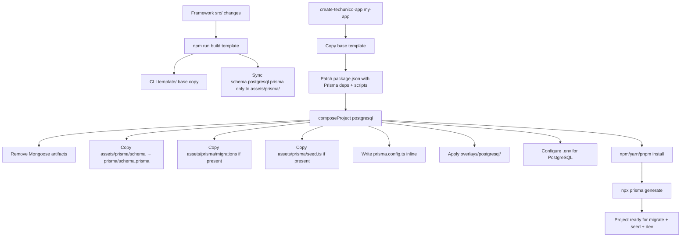

# Prisma Bootstrap & Project Generation — Impact Analysis

**Scope:** PostgreSQL project generation and Prisma lifecycle only  
**Repository:** Techunico Node Framework  
**Date:** June 28, 2026  
**Type:** Architecture review — no implementation

---

## 1. Executive Summary

Recent work has materially improved the PostgreSQL path. The CLI now composes database-specific projects via `composeProject()`, applies a PostgreSQL overlay, copies Prisma assets, runs `prisma generate` after install, and strips MongoDB artifacts. The `test-compose.js` harness validates that generated PostgreSQL projects typecheck with `prisma/`, `prisma.config.ts`, and `src/generated/prisma` present.

The remaining gap is not "whether Prisma works at generation time" — it largely does — but **how Prisma assets are sourced, kept in sync, and evolved across framework versions**. Today the system is a **partial hybrid (Option A)** with important inconsistencies:

| Area | Current State | Risk |
|------|---------------|------|
| Schema sync | `build-template.ts` syncs only `schema.postgresql.prisma` to CLI assets | Medium drift risk |
| Seed & migrations | Live only in `packages/create-techunico-app/assets/prisma/`; not synced from framework `prisma/` | **High drift risk** |
| `prisma.config.ts` | Inline string in `compose.js` | Maintainability debt |
| Framework dev DB | Multi-provider (`schema.postgresql.prisma`, `migrations_sqlite/`) | Diverges from generated single-schema model |
| Generated client | Correctly excluded from template; generated post-install | ✅ Correct |
| Upgrade model | Undefined | **High long-term risk** |

**Recommendation:** Adopt a **refined hybrid architecture (Option C)** — framework-owned canonical Prisma assets, fully synced into CLI assets at build time, composed into generated projects at generation time, with `prisma generate` run after dependency install. Do **not** use `npx prisma init`. Generated applications **own their schema after day one**; framework upgrades must not overwrite Prisma assets in existing apps.

---

## 2. Current Architecture Review

### 2.1 End-to-End PostgreSQL Generation Flow



### 2.2 Key Components

#### `build-template.ts` (framework → CLI sync)

```175:184:src/scripts/build-template.ts
fs.mkdirSync(cliTemplate, { recursive: true });
fs.cpSync(templateRoot, cliTemplate, { recursive: true });

if (fs.existsSync(resolve("prisma/schema.postgresql.prisma"))) {
  fs.mkdirSync(cliAssetsPrisma, { recursive: true });
  fs.copyFileSync(
    resolve("prisma/schema.postgresql.prisma"),
    path.join(cliAssetsPrisma, "schema.postgresql.prisma"),
  );
}
```

- Copies full `src/` into CLI `template/`, strips `src/generated`, excludes build scripts.
- **Does not** copy `prisma/seed.ts`, `prisma/migrations/`, or `prisma.config.ts` into CLI assets.
- **Does not** include any Prisma files in the base template (correct — DB is composed later).

#### `compose.js` — PostgreSQL setup

```136:182:packages/create-techunico-app/lib/compose.js
function setupPostgreSQL(projectRoot, assetsDir) {
  // ... removes mongoose artifacts ...
  
  fs.copyFileSync(schemaSource, schemaTarget);  // assets → prisma/schema.prisma
  
  if (fs.existsSync(migrationsSource)) {
    copyRecursive(migrationsSource, resolveProject(projectRoot, "prisma/migrations"));
  }
  
  if (fs.existsSync(seedSource)) {
    fs.copyFileSync(seedSource, resolveProject(projectRoot, "prisma/seed.ts"));
  }
  
  writeFile(projectRoot, "prisma.config.ts", `import "dotenv/config"; ...`);  // inline
  
  applyOverlay(projectRoot, overlayDir);  // overlays/postgresql/
}
```

#### CLI entry (`index.js`)

1. Copy base template  
2. Set Prisma dependencies and scripts (`generate`, `migrate`, `seed`)  
3. `composeProject()`  
4. `npm install`  
5. `runPrismaGenerate()` — only for PostgreSQL  
6. Print next steps: `migrate` → `seed` → `dev`

#### PostgreSQL overlay

Replaces DB-specific runtime files without touching unrelated framework code:

| Overlay file | Purpose |
|--------------|---------|
| `src/plugins/index.ts` | PostgreSQL-only `dbPluginMap` |
| `src/plugins/db-prisma/prisma.plugin.ts` | PG-only adapter (no SQLite branch) |
| `src/plugins/services.plugin.ts` | Wires `AuthService` with Prisma client |
| `src/modules/health/health.routes.ts` | Readiness via `app.db.getClient()` |
| `src/config/env.schema.ts` | `DB_PROVIDER: z.literal("postgresql")` |

#### Framework dev repo vs generated project

| Concern | Framework repo | Generated PostgreSQL app |
|---------|----------------|--------------------------|
| Schema file | `prisma/schema.postgresql.prisma` | `prisma/schema.prisma` |
| Config | Multi-provider `prisma.config.ts` with `DB_PROVIDER` | Single-provider `prisma.config.ts` |
| Migrations | `prisma/migrations_sqlite/` only | `prisma/migrations/` (init in CLI assets) |
| Seed import | `../src/generated/prisma` (stale) | `../src/generated/prisma/client` (correct for Prisma 7) |
| Client output | `../src/generated/prisma` | Same |

### 2.3 What Works Well

- **Composition model** — base template + DB overlay + asset injection is the right long-term pattern.
- **No generated client in template** — `src/generated` is stripped before template build.
- **`prisma generate` at CLI time** — generated projects typecheck immediately (verified by `test-compose.js`).
- **Starter migration shipped** — `20260628000000_init` gives a working `migrate dev` baseline.
- **Prisma 7 alignment** — driver adapter (`@prisma/adapter-pg`), `prisma.config.ts`, custom client output path.
- **Migrate deferred to developer** — correct; generation should not require a live database.

---

## 3. Impact Analysis

### 3.1 Template Structure — Static vs Dynamic

| Artifact | Should exist in generated project? | Source | Recommendation |
|----------|-----------------------------------|--------|----------------|
| `prisma/` directory | ✅ Yes | Composed at generation | Created by `composeProject`, not base template |
| `prisma/schema.prisma` | ✅ Yes | Framework canonical schema | Copy from synced CLI assets; rename from `schema.postgresql.prisma` |
| `prisma/seed.ts` | ✅ Yes | Framework canonical seed | Copy from synced CLI assets |
| `prisma/migrations/` | ✅ Yes (initial only) | Framework canonical init migration | Copy from synced CLI assets; **developer owns thereafter** |
| `prisma.config.ts` | ✅ Yes | Versioned template | Copy from assets template, not inline string |
| `src/generated/prisma/` | ✅ Yes (after generate) | **Never copied** | Always produced by `prisma generate` |

#### Static in generated project (copy at generation)

**Pros:** Familiar Prisma layout; works with standard Prisma CLI/docs; developer can edit immediately; migrations are versioned in their repo.

**Cons:** Must keep framework assets in sync; starter schema can drift from framework dev schema.

#### Dynamic generation (runtime string building)

**Pros:** Single place to change config; can inject project-specific values.

**Cons:** Harder to review/diff; no IDE validation; `compose.js` becomes a template engine; harder to test in isolation.

#### Never copy

- `src/generated/prisma/**` — machine output; platform-dependent; stale quickly.
- Framework-internal multi-provider files (`schema.sqlite.prisma`, `migrations_sqlite/`) — not relevant to generated PostgreSQL apps.

**Verdict:** Generated projects should contain the full standard Prisma tree (`prisma/`, `schema.prisma`, `seed.ts`, `migrations/`, `prisma.config.ts`). The framework should **compose** these at generation time from **versioned CLI assets**, not embed them in the base template and not build them from inline strings.

---

### 3.2 Prisma Bootstrap — Option Comparison

#### Option A: Generate Prisma files directly from framework assets *(current direction)*

| Dimension | Assessment |
|-----------|------------|
| Developer experience | **Strong** — project typechecks after `install` + `generate`; standard layout |
| Maintainability | **Medium** — requires disciplined asset sync pipeline |
| Framework evolution | **Strong** — framework controls starter schema, seed, init migration |
| Upgrade path | **Strong** — clear fork point: generated app owns schema after creation |
| Complexity | **Medium** — compose step + asset directory |

#### Option B: Run `npx prisma init` then customize

| Dimension | Assessment |
|-----------|------------|
| Developer experience | **Weak** — extra network call; defaults don't match framework (adapter, custom output, RBAC models, seed) |
| Maintainability | **Weak** — must maintain customization layer on top of changing `prisma init` output |
| Framework evolution | **Fragile** — `prisma init` output changes across Prisma versions |
| Upgrade path | **N/A** — only affects new projects; unpredictable diffs |
| Complexity | **High** — init + strip + overwrite + adapter wiring + schema injection |

`prisma.config_bak.ts` in the repo appears to be leftover `prisma init` output — evidence this path was explored and abandoned in favor of explicit config.

#### Option C: Refined hybrid *(recommended)*

Combine Option A's determinism with explicit pipeline rules:

1. **Canonical source:** `prisma/` in framework repo (PostgreSQL-focused subset for generation).
2. **Distribution:** `build-template` syncs full asset bundle → `packages/create-techunico-app/assets/prisma/`.
3. **Composition:** `composeProject` copies assets + overlay; writes nothing as inline strings.
4. **Generation:** `install` → `prisma generate` (optionally `postinstall` hook).
5. **Ownership:** Developer owns `prisma/` after generation; framework never auto-overwrites.

| Dimension | Assessment |
|-----------|------------|
| Developer experience | **Best** — deterministic, offline-capable, Prisma-native |
| Maintainability | **Best** — one sync pipeline, versioned templates, testable |
| Framework evolution | **Best** — new projects get new starter; existing projects unaffected |
| Upgrade path | **Best** — explicit fork-ownership model |
| Complexity | **Moderate** — slightly more build-template logic, far less compose magic |

**Verdict:** Option C supersedes both A and B. Option B should be rejected. Option A is correct in principle but incomplete in implementation.

---

### 3.3 Prisma Configuration — File Ownership Matrix

| File / Directory | Framework repo | CLI assets | Generated project | Dynamic at compose | Never copy |
|------------------|---------------|------------|-------------------|-------------------|------------|
| `prisma/schema.postgresql.prisma` | ✅ Canonical (dev) | ✅ Synced copy | ❌ | Renamed → `schema.prisma` | — |
| `prisma/schema.prisma` | ❌ | ❌ | ✅ | Via copy | — |
| `prisma/seed.ts` | ✅ Canonical | ✅ Synced | ✅ | Via copy | — |
| `prisma/migrations/` (init) | ✅ Should be canonical | ✅ Synced | ✅ | Via copy | — |
| `prisma/migrations/` (app-specific) | ❌ | ❌ | ✅ Developer-owned | ❌ | — |
| `prisma.config.ts` (multi-provider) | ✅ Framework dev only | ❌ | ❌ | ❌ | To generated apps |
| `prisma.config.ts` (single-provider template) | ❌ | ✅ Template file | ✅ | Via copy | — |
| `src/generated/prisma/` | ✅ Dev-generated locally | ❌ | ✅ Post-generate | `prisma generate` | **Never copy** |
| `src/plugins/db-prisma/` | ✅ Base + PG overlay | ❌ | ✅ Via overlay | ❌ | — |
| `schema.sqlite.prisma`, `migrations_sqlite/` | ✅ Framework dev only | ❌ | ❌ | ❌ | ✅ Never copy to PG apps |

---

### 3.4 Build Pipeline — Current vs Ideal

#### Current execution order

```
build-template
  → sync src/ to CLI template
  → sync schema.postgresql.prisma only

create-techunico-app
  → copy template
  → patch package.json
  → composeProject (assets + overlay + inline prisma.config.ts)
  → npm install
  → prisma generate
```

#### Ideal execution order

```
┌─────────────────────────────────────────────────────────┐
│ FRAMEWORK BUILD (maintainer)                            │
├─────────────────────────────────────────────────────────┤
│ 1. Develop prisma/schema.postgresql.prisma              │
│ 2. Develop prisma/seed.ts                               │
│ 3. Maintain prisma/migrations/ (postgresql init)        │
│ 4. Maintain assets/prisma/prisma.config.ts.template     │
│ 5. npm run build:template                               │
│    → sync src/ → CLI template                           │
│    → sync FULL prisma asset bundle → CLI assets         │
│ 6. npm run test:compose (CI)                            │
└─────────────────────────────────────────────────────────┘
                          ↓
┌─────────────────────────────────────────────────────────┐
│ PROJECT GENERATION (developer)                          │
├─────────────────────────────────────────────────────────┤
│ 1. Copy base template                                   │
│ 2. composeProject(postgresql)                           │
│    → inject prisma assets                               │
│    → apply postgresql overlay                           │
│    → configure .env                                     │
│ 3. Write package.json (deps + scripts)                  │
│ 4. npm install                                          │
│ 5. prisma generate                                      │
│ 6. Print: migrate → seed → dev                          │
└─────────────────────────────────────────────────────────┘
```

#### Pipeline improvements

| Improvement | Impact |
|-------------|--------|
| Extend `build-template` to sync seed + migrations + config template | Eliminates asset drift |
| Replace inline `prisma.config.ts` with asset template file | Reduces compose complexity |
| Add `postinstall: prisma generate` to generated `package.json` | Safer clones / manual installs |
| Add `migrate:deploy` and `studio` scripts | Production and DX completeness |
| Do **not** run `migrate` at generation time | Avoids DB dependency during scaffolding |
| CI assertion: framework schema ≡ assets schema ≡ composed output | Catches drift early |

---

### 3.5 Upgrade Strategy (v2.0 → v2.1 → v3.0)

#### Ownership model: **Fork at generation**

```
Framework v2.0                Generated App (day 0)
─────────────────            ─────────────────────
prisma/schema.postgresql  →  prisma/schema.prisma     [COPIED]
prisma/seed.ts            →  prisma/seed.ts           [COPIED]
prisma/migrations/init    →  prisma/migrations/       [COPIED]

Generated App (day 1+)
──────────────────────
prisma/**                  [DEVELOPER OWNED — framework must not overwrite]
```

#### What framework upgrades should do

| Asset class | New projects (v2.1 CLI) | Existing projects (v2.0 app) |
|-------------|-------------------------|-------------------------------|
| Starter schema | Ship updated init in assets | **Do not overwrite** — provide migration guide |
| Init migration | New projects only | **Do not overwrite** — app has its own history |
| `prisma.config.ts` | Ship updated template | Optional opt-in codemod only |
| `src/plugins/`, modules | Via overlay patterns | Documented manual merge or future `upgrade` CLI |
| Dependency versions | Pin in new `package.json` | Publish compatibility matrix |

#### Should generated projects own their schema completely?

**Yes.** After generation, the schema is application data, not framework code. The framework's role is to provide a **sensible starter** (RBAC models matching bundled auth module), not ongoing schema governance.

#### Should framework upgrades overwrite anything?

| Safe to overwrite (with tooling) | Never overwrite |
|----------------------------------|-----------------|
| `package.json` dependency bumps (opt-in command) | `prisma/schema.prisma` |
| Non-app-specific plugin boilerplate (opt-in codemod) | `prisma/migrations/**` |
| Documentation templates | `prisma/seed.ts` (once customized) |

---

## 4. Recommended Architecture

### 4.1 Asset Pipeline (Single Source of Truth)

```
framework/prisma/
├── schema.postgresql.prisma    ← canonical schema
├── seed.ts                     ← canonical seed
└── migrations_postgresql/      ← canonical init migration (new; mirror assets)
        ↓ build-template (full sync)
packages/create-techunico-app/assets/prisma/
├── schema.postgresql.prisma
├── seed.ts
├── migrations/
└── prisma.config.ts.template
        ↓ composeProject (postgresql)
generated-app/
├── prisma/schema.prisma
├── prisma/seed.ts
├── prisma/migrations/
├── prisma.config.ts
└── src/generated/prisma/       ← prisma generate only
```

### 4.2 Composition Rules

- **Base template:** DB-agnostic application skeleton (no `prisma/`, no `db-mongoose` or `db-prisma` until composed).
- **PostgreSQL compose:** inject Prisma assets + apply `overlays/postgresql/`.
- **MongoDB compose:** remove all Prisma artifacts + apply `overlays/mongodb/`.
- **Generated client:** always produced, never copied.

### 4.3 Prisma 7 Configuration Standard for Generated Apps

Generated projects should use a single, stable `prisma.config.ts`:

```typescript
import "dotenv/config";
import { defineConfig } from "prisma/config";

export default defineConfig({
  schema: "prisma/schema.prisma",
  migrations: {
    path: "prisma/migrations",
    seed: "ts-node prisma/seed.ts",
  },
  datasource: {
    url: process.env.DATABASE_URL,
  },
});
```

Consolidate seed configuration in `prisma.config.ts` (Prisma 7 primary). The `package.json` `"prisma": { "seed": ... }` block is redundant and can be removed from generated projects to avoid dual sources.

---

## 5. Recommended Project Generation Flow

```
Developer runs: npx @techunico/create-techunico-app my-api

1. Prompt: PostgreSQL selected
2. Copy DB-neutral template
3. composeProject(postgresql)
   ├── Remove mongoose artifacts
   ├── Copy prisma assets → prisma/
   ├── Copy prisma.config.ts.template → prisma.config.ts
   └── Apply postgresql overlay
4. Write package.json
   ├── @prisma/client, @prisma/adapter-pg, pg, prisma
   ├── scripts: generate, migrate, migrate:deploy, seed, studio
   └── postinstall: prisma generate  (recommended)
5. Configure .env (DATABASE_URL, DB_PROVIDER=postgresql)
6. npm install
7. prisma generate
8. Output:
   ├── "npm run migrate"   (requires running Postgres)
   ├── "npm run seed"      (optional)
   └── "npm run dev"
```

**Explicit non-goals at generation time:**

- Do not run `prisma migrate dev` (requires live DB + interactive prompts).
- Do not run `prisma db seed` (requires migrated DB).
- Do not invoke `npx prisma init`.

---

## 6. Risks

### Hidden technical debt

| Risk | Severity | Detail |
|------|----------|--------|
| Partial asset sync | **High** | Only schema is synced by `build-template`; seed/migrations maintained separately in CLI assets |
| Inline config generation | **Medium** | `prisma.config.ts` built as string in `compose.js` |
| Framework seed import path | **Medium** | Framework `prisma/seed.ts` uses `@/generated/prisma` path; assets version uses `/client` (Prisma 7) |
| No postgresql migrations in framework repo | **Medium** | Framework `migrate:pg` cannot validate same migration history as generated apps |
| Dual seed config | **Low** | `package.json` `prisma.seed` + `prisma.config.ts` `migrations.seed` |
| `prisma.config_bak.ts` | **Low** | Leftover from `prisma init` experiment |

### Upgrade risks

- Framework changes starter schema in v2.1 → existing v2.0 apps won't get RBAC model updates automatically (this is correct behavior, but undocumented).
- Without an explicit upgrade guide, developers may expect `npm update @techunico/...` to refresh their schema.
- Plugin overlay changes (e.g., `services.plugin.ts`) may diverge silently from older generated apps.

### Migration risks

- Shipping init migration in assets is correct, but if framework schema changes without a new migration in assets, new projects get schema/migration mismatch.
- Developers who run `migrate dev` before Postgres is running get a poor first experience (mitigated by clear CLI messaging — already partially done).

### Developer confusion

- Framework repo uses `schema.postgresql.prisma`; generated apps use `schema.prisma` — intentional but undocumented.
- Framework supports SQLite in dev; generated PostgreSQL apps do not — could confuse framework contributors.
- `npm run migrate` required before `seed`, but only mentioned in post-generation console output.

### Maintenance costs

- Every Prisma major version bump requires updating: assets schema, seed imports, config format, adapter packages, overlay plugin, and compose tests.
- Without full asset sync automation, each framework schema change is a **manual two-place edit**.

---

## 7. Priority Matrix

| Priority | Recommendation |
|----------|----------------|
| **Critical** | Extend `build-template.ts` to sync **full** Prisma asset bundle (schema + seed + migrations + config template) from framework `prisma/` to `packages/create-techunico-app/assets/prisma/` |
| **Critical** | Establish **fork-ownership** policy: generated apps own `prisma/**`; framework never overwrites in upgrades |
| **Critical** | Replace inline `prisma.config.ts` in `compose.js` with a versioned template file in CLI assets |
| **High** | Add postgresql init migrations to framework `prisma/` (or document CLI assets as canonical and remove `migrate:pg` from framework) |
| **High** | Add `postinstall: prisma generate` to generated PostgreSQL `package.json` |
| **High** | Align framework `prisma/seed.ts` import path with Prisma 7 (`/client` suffix) |
| **High** | Expand `test-compose.js` to assert seed, migrations, and `prisma.config.ts` content — not just directory presence |
| **Medium** | Add `migrate:deploy` and `studio` scripts to generated projects |
| **Medium** | Remove redundant `package.json` `"prisma": { "seed": ... }` from generated projects |
| **Medium** | CI check: `diff framework/prisma/schema.postgresql.prisma assets/prisma/schema.postgresql.prisma` must be empty after build |
| **Low** | Remove `prisma.config_bak.ts` |
| **Low** | Document schema naming convention (`schema.postgresql.prisma` in framework → `schema.prisma` in apps) |
| **Low** | Future: `npx @techunico/upgrade` CLI for opt-in runtime/plugin updates (not schema) |

---

## 8. Final Recommendation

**Adopt Option C: Refined Hybrid Asset Composition.**

### Do

1. Treat `prisma/schema.postgresql.prisma`, `prisma/seed.ts`, and `prisma/migrations/` as **framework-owned starter assets**, fully synced into CLI assets by `build-template`.
2. Compose all Prisma files into generated projects at generation time — not in the base template, not via `prisma init`, not as inline strings.
3. Run `prisma generate` after `npm install` during project creation; add `postinstall` as a safety net.
4. Ship an initial migration so `npm run migrate` applies a known baseline.
5. Let developers **fully own** their Prisma schema and migration history after generation.
6. On framework upgrades, update starter assets for **new projects only**; provide changelogs and optional codemods for existing apps.

### Do not

1. Run `npx prisma init` — it fights the framework's adapter model, custom output path, RBAC starter schema, and seed wiring.
2. Copy `src/generated/prisma` into templates or generated projects.
3. Run migrations during project generation.
4. Overwrite `prisma/**` in existing applications during framework version upgrades.
5. Copy framework-internal SQLite/multi-provider artifacts into PostgreSQL-generated apps.

### Expected outcome

| Goal | How this architecture delivers |
|------|-------------------------------|
| Developer experience | `create-app` → `install` → `generate` → typecheck passes → `migrate` → `seed` → `dev` |
| Maintainability | One sync pipeline; versioned templates; testable compose |
| Framework evolution | Framework iterates starter schema freely; existing apps unaffected |
| Minimal technical debt | Eliminates dual-maintenance, inline config, and partial sync |

This preserves the composition model already built in `compose.js` and `test-compose.js`, closes the asset-sync gaps in `build-template.ts`, and defines a clear long-term ownership boundary between framework starter content and application-owned Prisma state.